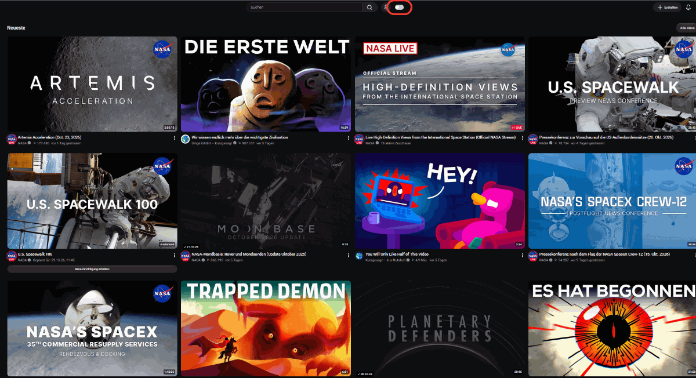
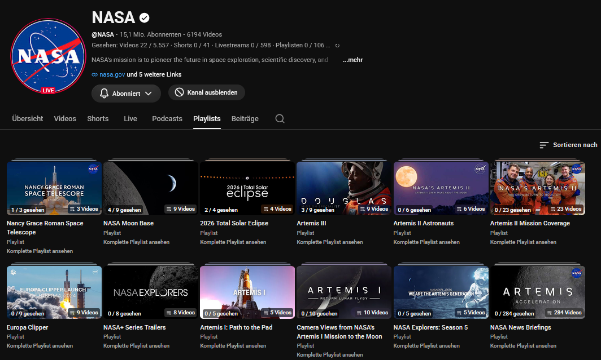
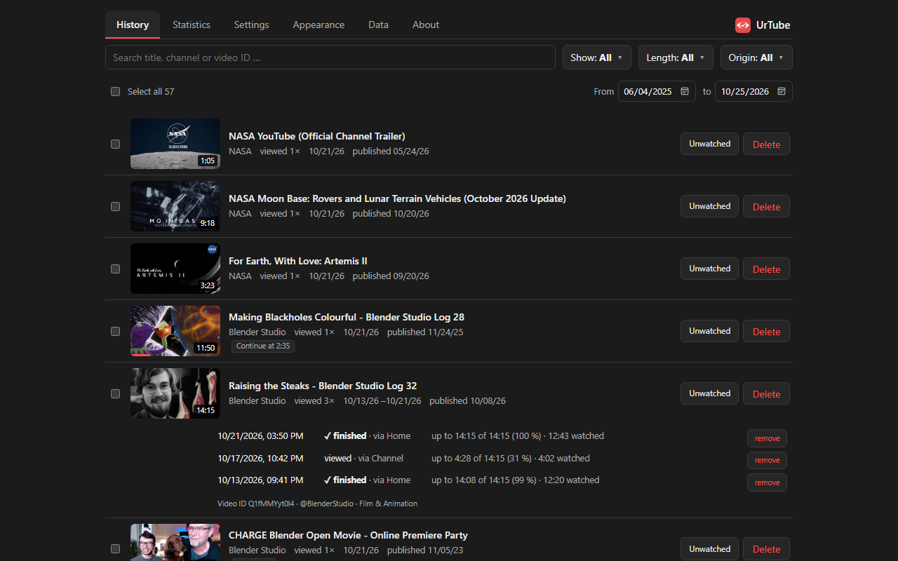
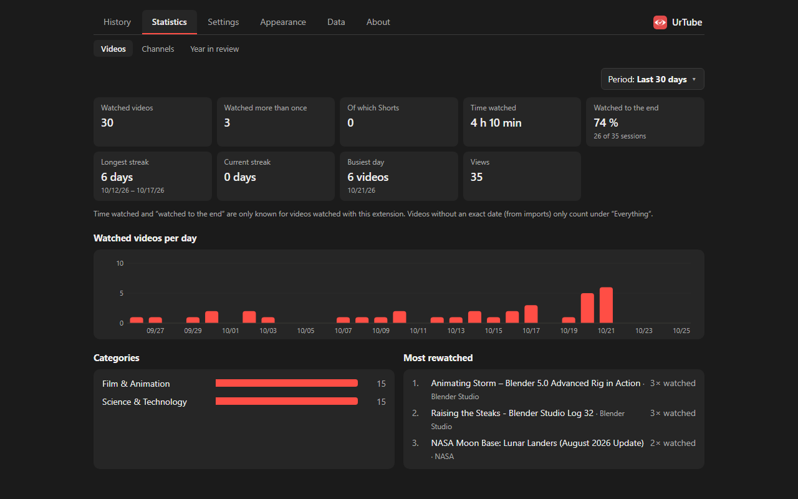

<p align="center"></p>

# UrTube

**Modern tracking for a better watching experience.**

A Firefox extension that remembers every YouTube video you watch, marks watched
videos everywhere on YouTube, hides them where you want, and shows your history
and statistics. Everything is stored locally in your browser – no server, no
account, no analytics. English and German.

**[Get UrTube for Firefox on addons.mozilla.org](https://addons.mozilla.org/firefox/addon/urtube/)**

<p align="center">
  
</p>
<p align="center">
  
  
  
</p>

## Features

- **Recording** – every video you open, with date, progress, where you came from
  and rewatches; continuing an unfinished video counts as one view. Optionally
  also the red progress bar, the Firefox history, the YouTube history (also from
  your phone or TV) and music played on music.youtube.com. Channel, length and
  date of videos known only by their ID are filled in from YouTube.
- **Marking** – watched thumbnails are faded, grayed out and/or get a “✓ date”
  badge, also among the suggestions and the channel's own videos at the end of
  a video; an eye button marks or unmarks a video by hand.
- **Hiding** – a switch in the YouTube header hides watched videos in
  subscriptions, on the home page, on channel pages (each with a time window),
  in playlists, search results and recommendations – before they appear. One
  switch for everything or one per area. Content filters for Shorts,
  premieres, live streams (also recordings of past streams), members-only
  videos, films and “Most relevant” – in subscriptions, optionally also on the
  home page and next to a video.
- **⊘ Hide** – hide videos, playlists or whole channels you are not interested
  in, without counting them as watched; they can stay hidden even while the
  switch is off and watched videos are shown.
- **Channels** – every channel page shows how many of its videos, Shorts, live
  streams and playlists you have watched (watched / total).
- **Playlists** – “12 / 23 watched” on playlist thumbnails; finished playlists
  can be hidden.
- **History** – searchable, with every view and filters (several at once) such as “Continue
  watching” (opens where you stopped), given up, without exact date, length,
  date range, origin, premieres and members-only; mark videos as finished or
  correct the music detection; export as CSV.
- **Statistics** – time watched, streaks, busiest day, categories, most
  rewatched videos, all your channels and subscriptions with your share, and a
  year in review.
- **Import** – Google Takeout (your full YouTube history with exact times) and
  YouTube Watchmarker exports. Imports never count anything twice; for every
  view the most exact date wins, and within the Takeout's time span its exact
  times replace Watchmarker's.
- **Clean up** – remove watched videos from “Watch later”, remove deleted
  videos from your YouTube history.
- **Playback** – a big player that fills the window in theater mode; the header
  hides and comes back at the top edge, with the player controls, or as normal
  theater mode with title and channel. Preferred resolution, speed and
  subtitles; channel trailers and live chat can stay quiet.
- **Backup** as a JSON file, with settings: restore (replace everything) or
  merge (add what is missing, e.g. from another computer).

## Why UrTube?

- **One add-on instead of several** – marking watched videos, tidying up your
  subscriptions, playlist progress, statistics and player settings share one
  database, instead of separate add-ons that each keep their own data.
- **Light on YouTube and your browser** – watched videos are hidden before they
  appear, and each page has a time window, so YouTube does not keep loading
  older and older videos until your feed (or the browser) gives up.
- **Much more than a checkmark** – history with filters, statistics, a year in
  review, progress per channel and playlist, continue where you stopped.
- **Easy to switch** – brings along your existing history from YouTube
  Watchmarker and Google Takeout; nothing is counted twice.
- **Actively developed** – made by a power user who uses it every day; ideas
  and bug reports go straight into the next version.
- **Clean, modern design** – light and dark, English and German, private by
  design: no server, no account, no analytics.

## Privacy

All data lives in the extension's IndexedDB in your Firefox profile. The
extension only talks to youtube.com, from inside your YouTube tabs and the same
way the site itself does (with your login) – to read playlists, channel video
lists, your subscriptions, your watch history and the details of single videos,
and to edit “Watch later” or your history when you ask it to. The
browser history is only read if you enable that sync and grant the permission.
Nothing is sent anywhere else.

## Install

- **Firefox:** from
  [addons.mozilla.org](https://addons.mozilla.org/firefox/addon/urtube/).
- **Chrome:** not yet (see [docs/DEVELOPMENT.md](docs/DEVELOPMENT.md#chrome)).

After installing, a short introduction opens; it can be shown again from the
About tab.

## Development

Requirements: Node.js 22, npm.

```bash
npm install
npm test          # unit tests (Vitest)
npm run check     # type check (svelte-check)
npm run build     # builds .output/firefox-mv2
npm run dev       # dev mode with auto-reload (starts its own Firefox)
```

Load the build temporarily: Firefox → `about:debugging#/runtime/this-firefox` →
*Load Temporary Add-on…* → select `.output/firefox-mv2/manifest.json`.

More: [docs/DEVELOPMENT.md](docs/DEVELOPMENT.md) (architecture, data model,
translations, releasing) and [CHANGELOG.md](CHANGELOG.md).

## Feedback and ideas

UrTube is a hobby project and keeps growing – feedback is very welcome!
[Report a bug](https://github.com/morikules/UrTube/issues/new?template=bug.yml),
[suggest an idea](https://github.com/morikules/UrTube/issues/new?template=idea.yml)
or leave a [review on addons.mozilla.org](https://addons.mozilla.org/firefox/addon/urtube/reviews/).
English or German is fine.

## Thanks

Built on the ideas of
[YouTube Watchmarker](https://github.com/sniklaus/youtube-watchmarker) by Simon Niklaus,
[Better Subscriptions for YouTube](https://github.com/OsaSoft/youtube-better-subscriptions) by Oscar Hernandez (OsaSoft) and
[Youtube Fullscreen Mode](https://greasyfork.org/scripts/434075-youtube-fullscreen-mode) by ndaesik.
No code was taken from these projects.

## License

[MIT](LICENSE) © 2026 morikules. Made with Claude Opus 5.5.

Not affiliated with YouTube or Google.
